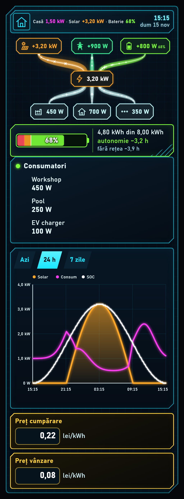
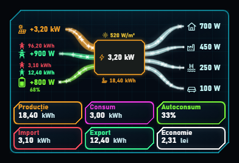
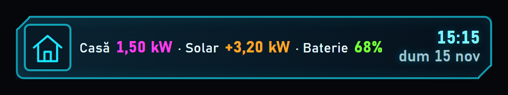
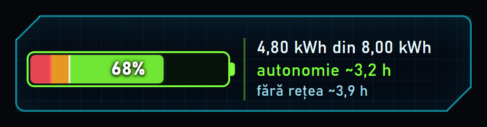

# Energy house card

[Română](README.ro.md) · English

[](https://hacs.xyz/docs/faq/custom_repositories/) [](https://github.com/AdrianTIonut/ha-energy-house-card/releases)  [](https://github.com/AdrianTIonut/ha-energy-house-card/actions) 

A [Home Assistant](https://www.home-assistant.io/) card for a house with **solar, grid and battery**: a flow diagram, daily statistics, battery runtime (with the reserve and shutdown levels of your inverter, and the backup runtime when the grid is gone), consumers, a 24 h / 7 day graph and editable energy prices. The flow is **animated**: the bands glow and dots and arrows run along them in the direction of the energy (they stop with “reduce motion”). One JavaScript file, no dependencies, no network access. Everything can be set up **from the Home Assistant UI** (visual editor with automatic sensor detection), no YAML needed.

<p>


</p>

> **Heads-up (first public version, 0.1.0).** The card was built for a wall tablet in Romania, so the text on the card is in **Romanian** (Casă, Solar, Baterie, Rețea, Consumatori…) and prices are shown in *lei/kWh*. The configuration editor is in English and Romanian. Translating the card itself is the next step. If you do not set the entity fields, the card looks for the author’s default sensor names (for a Deye inverter), so **always set your entities**, or press *Detect sensors automatically* in the editor.

## Installation

### Marketplace / HACS (custom repository)

1. **Settings → Marketplace** (HACS in older versions) → **Add from link** → `https://github.com/AdrianTIonut/ha-energy-house-card`, type **Dashboard**.
2. Install **Energy house card**, then reload the browser (Ctrl+F5).

### Manual

1. Download `ha-energy-house-card.js` from the [latest release](https://github.com/AdrianTIonut/ha-energy-house-card/releases/latest) into `config/www/energy-house-card/`.
2. **Settings → Dashboards → ⋮ → Resources → Add resource**: `/local/energy-house-card/ha-energy-house-card.js?v=1`, type **JavaScript module**. Change the number after each update.

### Updating

Install the update from the Marketplace / HACS and reload the browser. In the mobile app: Settings → Companion app → Debugging → *Reset frontend cache* (or close the app completely and open it again). Manual install: replace the file and change the number in `?v=` of the resource.

## Setup from the UI

**Add card → Energy house card**: the editor opens with blocks for what to show, power sensors, consumers, battery, daily energy, prices and look. *Detect sensors automatically* fills the solar, grid, battery level and capacity sensors it finds (by unit and name). Check the signs in the preview: if your grid meter is **+ when exporting**, tick *Meter is + when exporting*.

Or in YAML:

```yaml
type: custom:energy-house-card
sections: [compact, compact_stats]      # a narrow column: compact flow + statistics
pv_entity: sensor.solar_power
grid_entity: sensor.grid_meter_power    # one signed meter (+ = import); or import_entity + export_entity
charge_entity: sensor.battery_charge_power
discharge_entity: sensor.battery_discharge_power
soc_entity: sensor.battery_soc
battery_capacity_kwh: 10
battery_reserve_pct: 20                 # kept for outages
battery_shutdown_pct: 10                # the inverter stops here
consumers:
  - { name: Pool, power: sensor.pool_power, icon: mdi:pool }
  - { name: EV charger, power: sensor.ev_power, icon: mdi:car-electric }
```

What is not measured by a consumer stays under **Casă** (house): the card computes it from production, grid and battery.

## Sections

`sections` picks the blocks and their order; leave it out for the whole card.

| Section | What it shows |
|---|---|
| `header` | one line: house power, solar, battery level, clock and date |
| `tiles` | Solar / Grid / Battery / House tiles |
| `graph` | 24 h and 7 day graph (solar, consumption, battery level) |
| `flow` | flow diagram: sources → total → destinations |
| `consumers` | consumers with power, share and a bar |
| `battery` | battery body with the zones, usable energy, runtime and backup runtime |
| `inverters` | per-inverter production (optional, for Deye / Huawei style systems) |
| `stats` | daily statistics: production, consumption, self-consumption, import, export, savings |
| `prices` | buy / sell price boxes you can edit on the card |
| `compact` | small flow for narrow columns (≈ 340 px) |
| `compact_stats` | six daily statistics in two rows |

<p>


</p>

## Configuration reference

**Power sensors** (W or kW): `pv_entity`, `grid_entity` (+ `grid_invert: true` if + means export) **or** `import_entity` and `export_entity`, `charge_entity`, `discharge_entity`.

**Battery**: `soc_entity` (%), `battery_capacity_entity` or `battery_capacity_kwh`, `battery_reserve_entity` or `battery_reserve_pct`, `battery_shutdown_entity` or `battery_shutdown_pct`, `grid_present_entity` (`on`/`off`, or a voltage with `grid_present_min`, default 50). With the grid, runtime = (level − reserve) × capacity ÷ house load; without it the card shows the backup runtime down to the shutdown level, and the capacity line shows the usable energy.

**Daily energy**: `pv_daily_entity`, `import_daily_entity`, `export_daily_entity`, `import_monthly_entity`, `bat_charge_daily_entity`, `bat_discharge_daily_entity`, `radiation_entity` (optional).

**Prices**: `tarif_entity` (buy) and `pret_export_entity` (sell): two `input_number` helpers; the card edits them with `input_number.set_value`.

**Consumers**: `consumers: [{ name, power, energy_today?, icon?, group? }]`, up to 12.

**Look**: `style` (`cyber` | `glass`), `flow_style: open` (icons and values only), `flow_layout` (`auto` | `vertical` | `horizontal`), `flow_shape` (`auto` | `square` | `wide`), `accent_color`, `card_background`, `battery_color` (`#rrggbb`), `show_total`, `show_clock`, `compact_extras`, `grid_info`, `show_solar` / `show_grid` / `show_battery` (`true` / `false` to force; otherwise shown when the entity exists).

Colors: solar orange, export and charging green, import red, consumption magenta.

## Troubleshooting

- **“Custom element doesn't exist: energy-house-card”**: the resource is not loaded. Check Settings → Dashboards → ⋮ → Resources (type *JavaScript module*), then force-refresh (Ctrl+F5).
- **Values show “—”, or the card shows names you do not have**: the entities are not set. Press *Detect sensors automatically* in the editor, or set them by hand (Developer tools → States has the exact ids).
- **Import and export look swapped**: tick *Meter is + when exporting* (`grid_invert: true`), or use `import_entity` and `export_entity`.
- **The runtime shows “—”**: it needs the battery level (`soc_entity`), the capacity and the house load.
- **The price boxes do nothing**: `tarif_entity` and `pret_export_entity` must be `input_number` helpers.
- **The texts are in Romanian**: the card itself is not translated yet (see the note at the top); the editor is in English and Romanian.
- **A new option does nothing after an update**: change the `?v=` number in the resource and force-refresh.

## Development

```bash
node build.js            # builds energie-casa-card.js and ha-energy-house-card.js from src/ (no dependencies)
node tests/run-all.mjs   # all tests
node docs/demo/capture.mjs   # regenerates docs/img from the fake-data demo (needs Chrome)
```

`docs/demo/index.html` is a demo with a fake Home Assistant (invented entities). Rules: no network, no libraries, every config text is escaped, a missing value is shown as “—”.

## License

MIT
