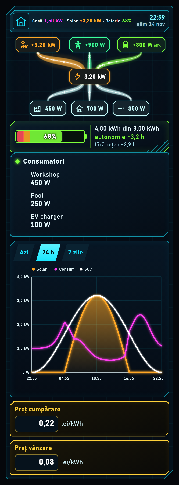
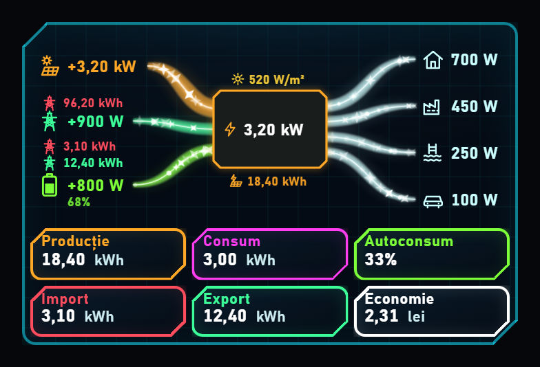
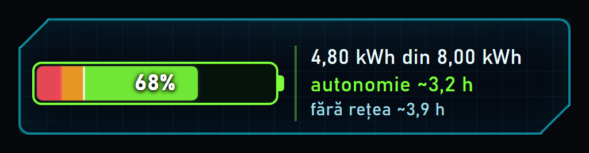

# Card energie casă (Energy house card)

Română · [English](README.md)

Card pentru [Home Assistant](https://www.home-assistant.io/), pentru o casă cu **solar, rețea și baterie**: diagramă de flux, statistici zilnice, autonomia bateriei (cu rezerva și pragul de oprire ale invertorului, plus autonomia de backup când pică rețeaua), consumatori, grafic 24 h / 7 zile și prețuri editabile. Un singur fișier JavaScript, fără dependențe, fără rețea. Se configurează **din interfața Home Assistant** (editor vizual cu detectare automată a senzorilor), fără YAML.

<p>


</p>

> **Atenție (prima versiune publică, 0.1.0).** Cardul a fost făcut pentru o tabletă de perete din România: textul de pe card e în română, iar prețurile sunt în *lei/kWh*. Editorul e în engleză și română. Traducerea cardului în sine urmează. Dacă nu setezi entitățile, cardul caută numele implicite ale autorului (pentru un invertor Deye), deci **setează-ți mereu entitățile** sau apasă *Detectează automat senzorii* în editor.

## Instalare

- **Marketplace / HACS (repository personalizat):** Setări → Marketplace → **Add from link** → `https://github.com/AdrianTIonut/ha-energy-house-card`, tip **Dashboard**; apoi reîncarci browserul.
- **Manual:** copiezi `ha-energy-house-card.js` din [ultimul release](https://github.com/AdrianTIonut/ha-energy-house-card/releases/latest) în `config/www/energy-house-card/` și adaugi resursa `/local/energy-house-card/ha-energy-house-card.js?v=1` (tip **Modul JavaScript**).

## Configurare din interfață

**Adaugă card → Energy house card**: editorul are blocuri pentru ce se afișează, senzori de putere, consumatori, baterie, energie zilnică, prețuri și aspect. *Detectează automat senzorii* completează senzorii de solar, rețea, nivel și capacitate bateriei, după unitate și nume. Verifică semnele în previzualizare: dacă contorul tău e **+ la export**, bifează *Contorul e + la export*.

În YAML (același card):

```yaml
type: custom:energy-house-card
sections: [compact, compact_stats]      # coloană îngustă: flux compact + statistici
pv_entity: sensor.solar_power
grid_entity: sensor.contor_retea        # un contor cu semn (+ = import); sau import_entity + export_entity
charge_entity: sensor.baterie_incarcare
discharge_entity: sensor.baterie_descarcare
soc_entity: sensor.baterie_nivel
battery_capacity_kwh: 10
battery_reserve_pct: 20                 # păstrat pentru pană de curent
battery_shutdown_pct: 10                # aici se oprește invertorul
consumers:
  - { name: Piscină, power: sensor.piscina_putere, icon: mdi:pool }
```

Ce nu e măsurat de un consumator rămâne la **Casă**: cardul îl calculează din producție, rețea și baterie.

## Secțiuni

`sections` alege blocurile și ordinea lor; fără el apare tot cardul: `header` (antet), `tiles` (plăcuțe), `graph`, `flow`, `consumers`, `battery`, `inverters`, `stats`, `prices`, `compact` (flux mic pentru coloane de ~340 px), `compact_stats`.

<p>


</p>

## Opțiuni

Lista completă de opțiuni (senzori de putere, baterie, energie zilnică, prețuri, consumatori, aspect) e în [README-ul în engleză](README.md#configuration-reference); numele cheilor sunt aceleași.

## Dezvoltare

```bash
node build.js            # produce energie-casa-card.js și ha-energy-house-card.js din src/
node tests/run-all.mjs   # toate testele
node docs/demo/capture.mjs   # regenerează docs/img din demo-ul cu date inventate (cere Chrome)
```

Licență: MIT.
